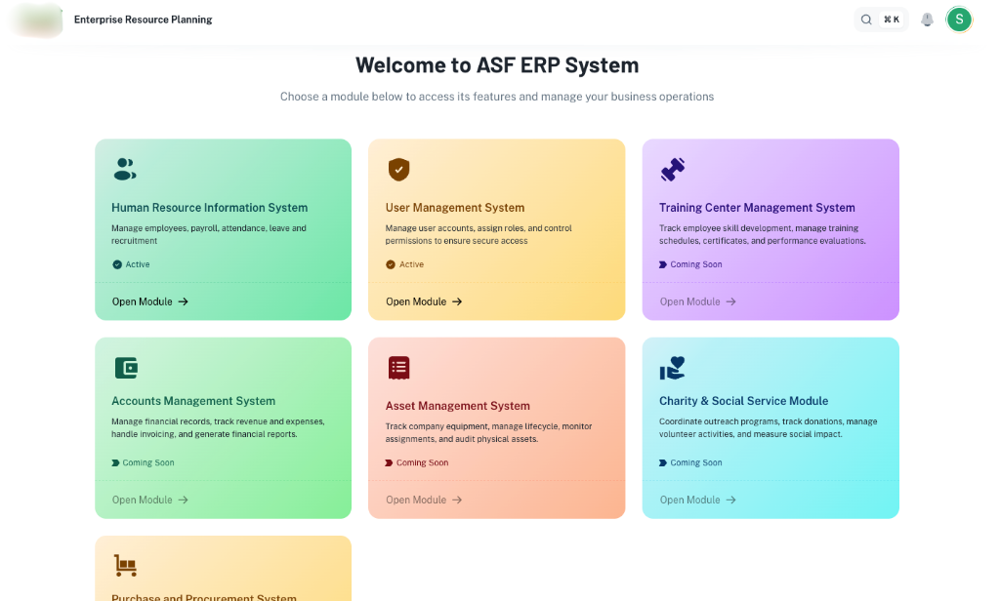
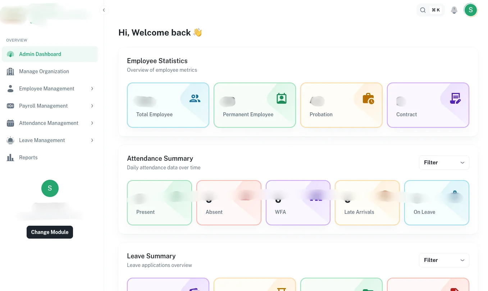
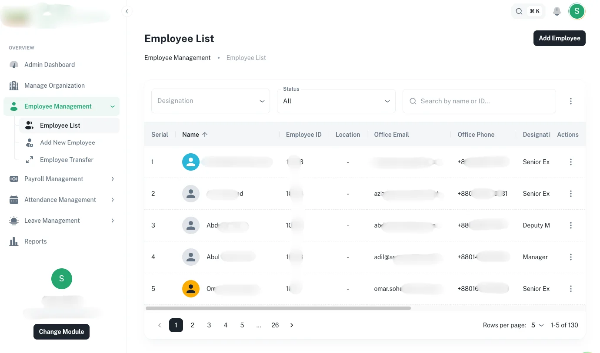
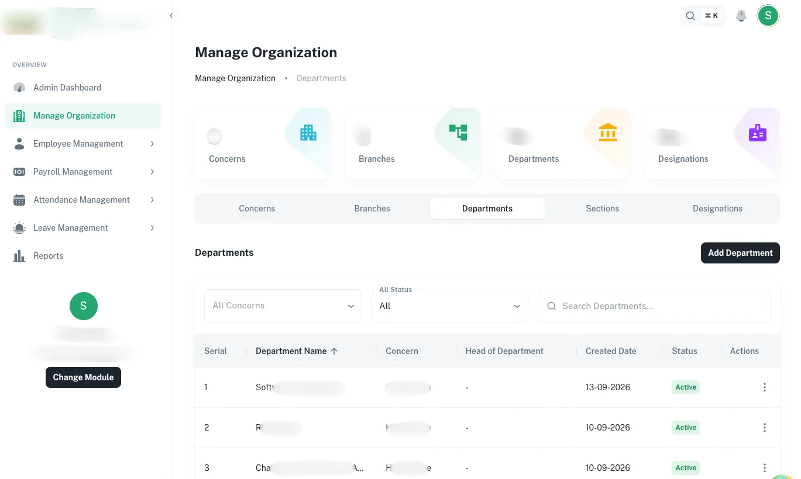
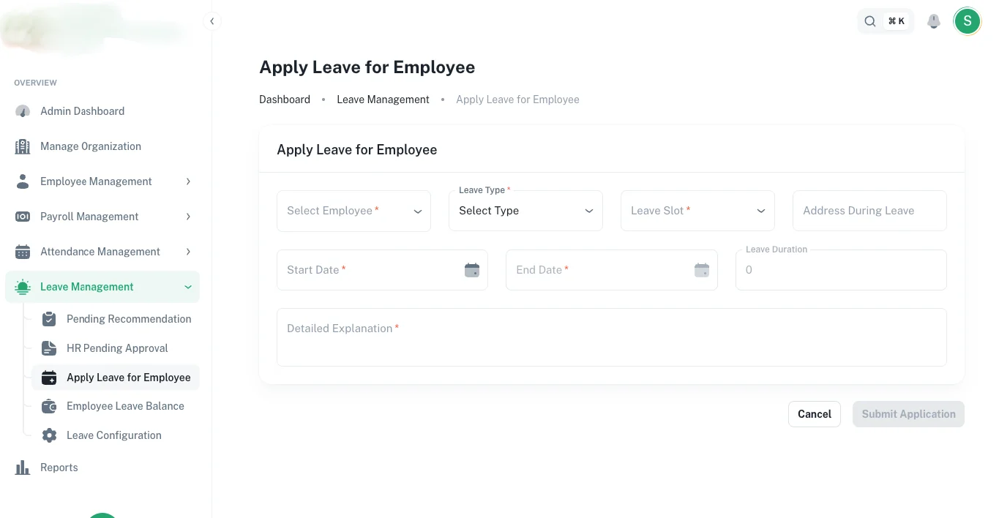
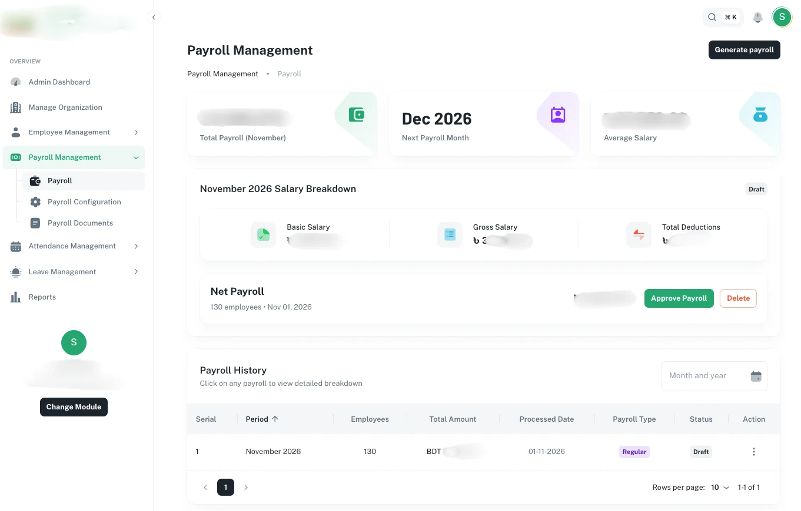

# 🏢 Enterprise Resource Planning (ERP) Frontend Architecture

[](https://react.dev)
[](https://www.typescriptlang.org/)
[](https://vitejs.dev)
[](https://tanstack.com/router)
[](https://tanstack.com/query)
[](https://mui.com)
[](#-confidentiality--nda-notice)

> **Lead Frontend Engineer:** [Omor Faruk](https://github.com/OmorFaruk63)  
> **Live Architecture Showcase:** [https://omorfaruk63.github.io/erp-frontend-case-study/](https://omorfaruk63.github.io/erp-frontend-case-study/)  
> **Domain Focus:** Human Resource Management (HRM), Attendance Tracking, Payroll Automation, and Enterprise Role-Based Access Control (RBAC).

---

## ⚡ Executive Summary

This repository documents the frontend client architecture of an enterprise-grade ERP platform engineered for corporate operations. The system was designed to eliminate fragmented spreadsheets and manual delays across employee lifecycle workflows, biometric attendance reconciliation, multi-tier leave authorizations, and payroll disbursements.

As the **Frontend Developer**, I engineered the modular architecture, implemented granular role-based security barriers, and guaranteed seamless rendering for large-scale data tables (>5,000 records) with sub-second interaction latencies.

---

## 📸 Visual Showcase & Core Modules

### 1. Multi-Module Enterprise Hub
Centralized portal gateway routing authenticated organizational personnel to domain services (HRIS, UMS, Accounts, Asset Management, and Charity operations).


### 2. Executive Analytics Dashboard
Real-time KPI visualization covering departmental headcount, pending approvals, and attendance distribution powered by ApexCharts.


### 3. Virtualized Employee Directory (MUI X-DataGrid)
Virtual table rendering 5,000+ employee records at a steady 60 FPS with debounced querying, column pinning, and bulk operations.


### 4. Organizational Hierarchy Structure
Multi-tier governance view managing concerns, branches, departments, sections, and designations.


### 5. Multi-Step Leave Application Workflow
Dynamic leave request workflow preserving complex form drafts across steps with strict schema validation.


### 6. Payroll Engine & Compensation Pipeline
Automated net salary calculations, basic allowances, tax/PF deductions, and client-side instant PDF pay-slip generation.


---

## 📊 Measurable Impact & Metrics

| Metric | Before / Baseline | After Implementation | Engineering Solution |
| :--- | :--- | :--- | :--- |
| **Initial View Load** | ~2.5s (monolithic) | **< 1.2s** | Route-level code splitting via TanStack Router & Vite |
| **DataGrid Interaction** | ~180ms lag / frame drops | **60 FPS** | DOM virtualization on 5,000+ records via `@mui/x-data-grid` |
| **Form Error Rates** | ~35% (unvalidated steps) | **< 5%** | Real-time schema validation with React Hook Form + Zod |
| **Report Export Time** | 6 - 8s (server queues) | **< 800ms** | Client-side document generation using ExcelJS and jsPDF |
| **Route Access Leaks**| Vulnerable to URL tampering| **0%** | TanStack Router `beforeLoad` auth guards & `<PermissionGate>` |

---

## 🏗️ Technical Architecture & Data Flow

```
┌────────────────────────────────────────────────────────────────────────┐
│                   Type-Safe TanStack Router Layer                      │
│             (Tree-based routes, beforeLoad RBAC guards)                │
└───────────────────────────────────┬────────────────────────────────────┘
                                    │
    ┌───────────────────────────────┼───────────────────────────────┐
    ▼                               ▼                               ▼
┌─────────────────────────┐ ┌─────────────────────────┐ ┌─────────────────────────┐
│       HRM Module        │ │       UMS Module        │ │     Payroll & Leaves    │
│  - Org Tree Hierarchy   │ │  - RBAC Scope Validator │ │  - Multi-tier Approvals │
│  - Employee Directory   │ │  - User Credentials     │ │  - Payslip Generation   │
│  - Virtual DataGrid     │ │  - Session Tokens       │ │  - Attendance Logs      │
└───────────┬─────────────┘ └───────────┬─────────────┘ └───────────┬─────────────┘
            │                           │                           │
            └───────────────────────────┼───────────────────────────┘
                                        │
           ┌────────────────────────────┴───────────────────────────┐
           ▼                                                        ▼
┌─────────────────────────────────────┐  ┌─────────────────────────────────────┐
│       TanStack Query v5 Cache       │  │             Zustand v5              │
│ - Infinite pagination keys          │  │ - Sidebar toggle & layout states    │
│ - Optimistic updates & mutations    │  │ - Temporary search / filter presets │
│ - Automatic background refetching   │  │ - Active drawer / modal visibility  │
└──────────────────┬──────────────────┘  └─────────────────────────────────────┘
                   │
                   ▼
┌─────────────────────────────────────┐
│          Axios Interceptors         │
│ (JWT bearer injection, refresh loop,│
│  global 401/403/500 toast handlers) │
└─────────────────────────────────────┘
```

---

## 🛠️ Core Engineering Challenges Solved

### 1. Zero-Lag Table Virtualization (>5,000 Records)
* **Challenge:** High DOM memory footprints and sluggish scrolling during heavy multi-departmental attendance audits.
* **Solution:** Integrated `@mui/x-data-grid` row and column virtualization, memoized cell renderers with `React.memo`, and debounced search filters by 400ms to eliminate redundant API dispatches.

### 2. Type-Safe Role-Based Access Control (RBAC)
* **Challenge:** Multi-tier permission requirements (Super Admin, HR Officer, Manager, Employee) requiring protection at both the route and component levels.
* **Solution:** Orchestrated TanStack Router `beforeLoad` guards to validate session tokens prior to route bundle evaluation. Built declarative `<PermissionGate allowedRoles={[...]}>` components for fine-grained button and action gating.

### 3. Server-Free Client-Side Export Engine
* **Challenge:** Generating thousands of monthly employee salary slips placed heavy queue loads on backend microservices.
* **Solution:** Built client-side document compilers using `exceljs` and `jspdf-autotable`, rendering styled multi-tab spreadsheets and branded payroll audit PDFs directly in the browser within 800ms.

---

## 💻 Tech Stack Breakdown

- **Core:** React 19, TypeScript 5.9, Vite 7
- **Routing & State:** TanStack Router v1, TanStack Query v5, Zustand v5
- **UI Components:** Material UI (MUI v7), MUI X-DataGrid, ApexCharts, FullCalendar
- **Forms & Validation:** React Hook Form v7, Zod v4
- **Reporting & File I/O:** ExcelJS, jsPDF, jsPDF-AutoTable, File-Saver
- **Architecture Enforcement:** ESLint Boundaries, Commitlint, Husky, Playwright

---

## 🔒 Confidentiality & NDA Notice

*This repository is a sanitized architectural case study of an internal enterprise ERP suite. In compliance with Non-Disclosure Agreements (NDA), proprietary backend API endpoints, commercial identifiers, client logos, and personal employee records have been redacted or replaced with synthetic demonstration data.*

---

## 👤 Author & Contact

**Omor Faruk**  
*Frontend Engineer (React 19 | Next.js | TypeScript)*  
- 📍 Dhaka, Bangladesh  
- 📞 +880 1789-593926  
- ✉️ [omor3710@gmail.com](mailto:omor3710@gmail.com)  
- 🔗 [LinkedIn](https://www.linkedin.com/in/omor-faruk-developer) &bull; [GitHub](https://github.com/OmorFaruk63)
